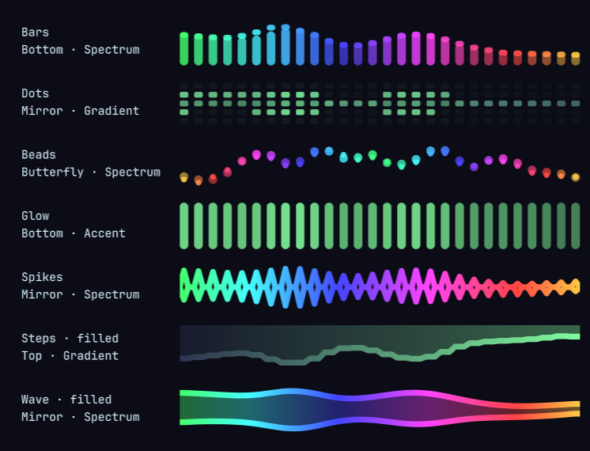

# Spectra

Audio spectrum for the [Omarchy](https://omarchy.org/) bar — four styles, one
shared capture, and it gets out of the way when the room is quiet.



## Styles

| Style | What it looks like |
|-------|--------------------|
| **Bars** | Classic rectangles with falling peak-hold caps. |
| **Dots** | An LED ladder: each band lights cells from the baseline, with the peak cell held bright. |
| **Wave** | The spectrum as a single stroked line over a faint body. |
| **Area** | The same curve with the body filled in. |

Each style can grow up from the baseline, down from the ceiling, or out from a
centre line (`mode`), in a flat theme colour, a level-driven gradient, or a hue
sweep anchored on your accent (`color`).

## Switching, without opening anything

- **Scroll** over the widget to step through the styles.
- **Middle click** for the next style, **right click** for the next colour.
- **Left click** opens the audio panel.
- From a keybinding or a script:

```bash
omarchy-shell radius.spectra cycleStyle
omarchy-shell radius.spectra setStyle Wave
omarchy-shell radius.spectra cycleColor
omarchy-shell radius.spectra reload      # re-arm the capture
```

Every switch is written back to `~/.config/omarchy/shell.json`, so what you land
on is what you get after a restart.

## Requirements

- Omarchy / `omarchy-shell`
- [`cava`](https://github.com/karlstav/cava) — `omarchy pkg add cava`
- PipeWire (used through `pipewire-pulse`)

## Install

```bash
omarchy plugin add https://github.com/kevincardwell/omarchy-spectra --enable
omarchy bar move radius.spectra --section left --after omarchy.menu
```

## Settings

All of it is editable from the widget's settings form, or inline in
`shell.json`:

```json
{ "id": "radius.spectra", "style": "Bars", "bars": 28, "mode": "Mirror", "color": "Spectrum" }
```

| Key | Default | What it does |
|-----|---------|--------------|
| `style` | `Bars` | `Bars`, `Dots`, `Wave`, `Area`. |
| `mode` | `Bottom` | `Bottom`, `Mirror`, `Top`. |
| `color` | `Accent` | `Accent`, `Foreground`, `Muted`, `Gradient`, `Spectrum`. |
| `bars` | `28` | Frequency bands, 4–64. |
| `barWidth` | `3` | Bar width in logical pixels. |
| `gap` | `2` | Space between bars. |
| `fill` | `62` | Percentage of the bar's height the spectrum may use. |
| `sensitivity` | `100` | Percent scaling of the incoming levels. |
| `punch` | `140` | Bends the level curve so quiet passages still lift off the baseline. 100 is linear. |
| `smoothing` | `35` | Spreads each peak into its neighbours. 0 shows raw FFT bins, which look spiky. |
| `attack` | `80` | How fast a band rises to a transient. |
| `release` | `45` | How slowly it sinks back. |
| `peakHold` | `true` | Falling cap at each band's most recent peak. |
| `autoHide` | `true` | Fold the widget away after ~2s of silence. |
| `idleSuspend` | `true` | Stop the cava process entirely while nothing is routed to an output. |
| `framerate` | `60` | Capture rate handed to cava. |

Colours come from Omarchy's `Color` singleton, so a theme change recolours
everything live.

## How it behaves

**One capture, every monitor.** The bar instantiates a widget per screen, so
the cava process lives in a `service`-kind plugin instead. Widgets register
what they want and the most generous request wins; two differently configured
instances still share one capture.

**It idles out.** With `idleSuspend` on, cava is stopped whenever nothing is
routed to an output at all, and comes back as soon as something is — a desktop
with no player open pays nothing for the widget. `autoHide` is the visual half
of the same idea: after a couple of seconds of silence the widget folds to zero
width and the bar closes up around it.

**It is smoothed twice, for different reasons.** Along the spectrum, each band
claims the best of its neighbours attenuated by distance, so a peak becomes a
shoulder rather than a spike. Over time, bands rise fast and fall slowly, at the
screen's refresh rate rather than cava's — so the motion is identical at 60Hz
and 144Hz, and a capture framerate of 30 still looks fluid.

**Vertical bars work.** Bands stack top to bottom and grow sideways, with
`mode` picking the edge they grow from.

## Remove

```bash
omarchy plugin disable radius.spectra
omarchy plugin remove radius.spectra --yes
```

## License

MIT
